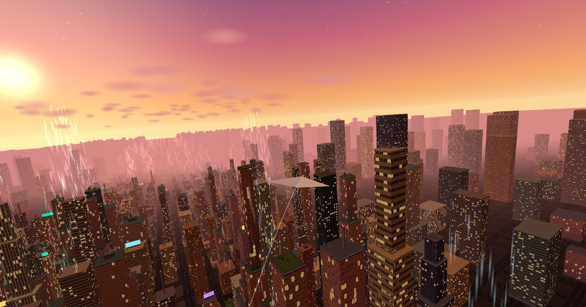
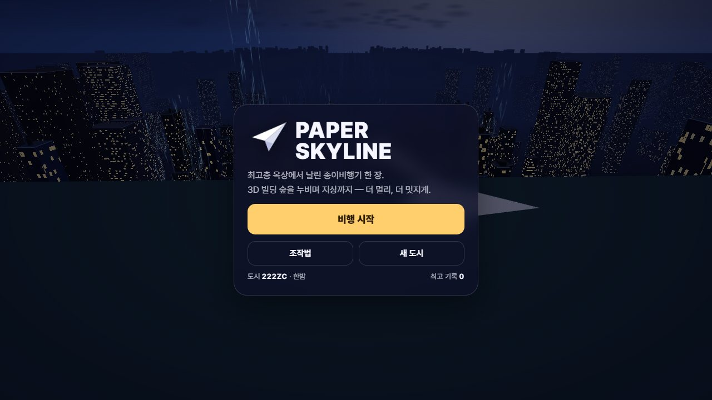
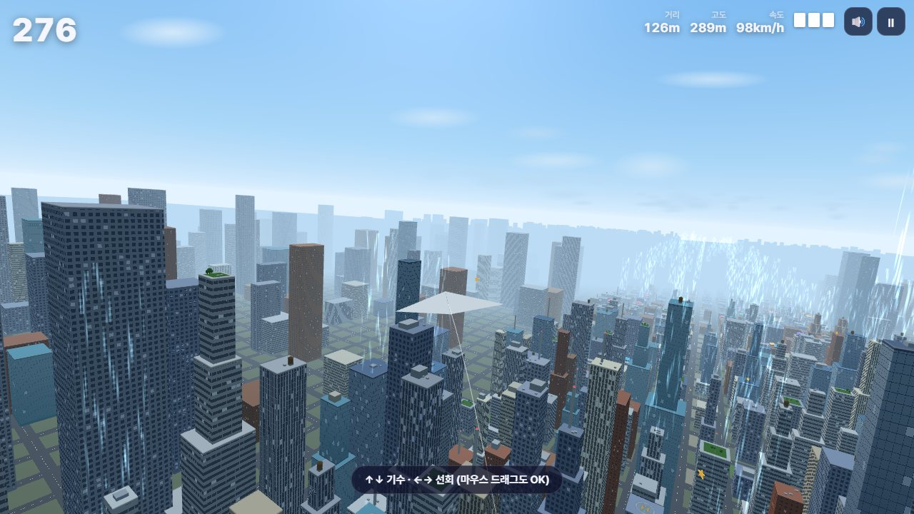

<div align="center">



# ✈️ PAPER SKYLINE

**최고층 옥상에서 날린 종이비행기 한 장.<br/>3D 빌딩 숲을 누비며 지상까지 — 더 멀리, 더 멋지게.**

[](https://jeiel85.github.io/paper-skyline/)


</div>

---

## 🌆 어떤 게임인가요?

320m 높이의 타워 옥상에서 종이비행기를 던집니다. 그 다음부터는 바람과 중력, 그리고 당신의 손끝이 전부입니다.

- 🏙️ **매번 새로운 3D 도시** — 시드 기반 절차 생성. 수천 채의 빌딩이 앞으로 갈수록 낮아지며 끝없이 이어집니다.
- 🏗️ **제각각인 빌딩들** — 계단식 마천루 · 포디움 위 타워 · 유리 커튼월 · 가로띠창 · 세로 핀 · 벽돌 건물. 옥상엔 펜트하우스, 물탱크, 네온 광고판, 헬리패드, 옥상 정원이 있고 빈 블록은 공원과 광장이 됩니다. 계단·물탱크·광고판도 모두 실제로 부딪힙니다.
- 🪁 **진짜 같은 활공 물리** — 양력·항력·실속·지면 효과. 기수를 들면 속도를 잃고, 내리면 속도를 얻습니다.
- 🌀 **기술 = 점수** — 골목을 낮게 질주하고, 옥상을 스치고, 다이브 후 풀업으로 루프를 그리세요. 연속 성공하면 콤보 배율이 ×5까지.
- 🌅 **세 가지 하늘** — 노을 · 한밤 · 맑은 낮. 도시마다 시간대가 다릅니다.
- 📤 **도전장 공유** — 끝난 순간의 3D 장면이 담긴 점수 카드 + **같은 도시**에서 겨루는 챌린지 링크.

<table>
  <tr>
    <td></td>
    <td></td>
  </tr>
  <tr>
    <td align="center"><sub>한밤의 도시 · 타이틀 화면</sub></td>
    <td align="center"><sub>맑은 낮 · 상승기류 기둥과 첨탑</sub></td>
  </tr>
</table>

## 🎮 조작법

| | 키보드 | 터치 / 마우스 |
|---|---|---|
| **던지기** | `Space` 두 번 (각도 → 파워) | 화면 탭 두 번 |
| **기수 올리기** | `↑` / `W` | 누른 채 **위로** 드래그 |
| **다이브** | `↓` / `S` | 누른 채 **아래로** 드래그 |
| **선회** | `←` `→` / `A` `D` | 누른 채 **좌우로** 드래그 |
| **일시정지 · 소리** | `Esc` / `P` · `M` | 우측 상단 버튼 |

> 💡 **루프 요령** — 2초쯤 다이브해서 속도를 모은 뒤, 기수를 끝까지 당기세요.

## 🏆 점수

**점수 = 전진 거리(m) + Σ(액션 점수 × 콤보 배율)**

| 액션 | 조건 | 기본 점수 |
|---|---|---:|
| 🫣 아슬아슬! | 벽·첨탑 옆을 2m 이내로 스침 (빌딩당 1회) | 80 |
| 🏢 옥상 스치기 | 옥상 바로 위(4.5m 이내)를 0.5초 이상 활공 | 80 + 120/초 |
| 🛣️ 골목 질주 | 양옆 빌딩보다 낮게 골목을 0.7초 이상 통과 | 60 + 150/초 |
| 🛫 터치 앤 고 | 옥상에 닿았다가 다시 날아오름 | 150 |
| 🔄 루프! | 피치로 한 바퀴 | 400 |
| 🌪️ 360° 선회 | 뱅크로 한 바퀴 | 250 |
| 💨 상승기류 | 환풍구 기류 타기 | 50 |
| ⭐ 종이별 | 떠 있는 별 수집 | 100 |
| ⚡ 음속 종이 | 151km/h 이상을 1.2초 유지 | 120 |
| 🛬 완벽한 착지 | 수평 자세로 사뿐히 지상 착지 | 600 |

- 액션을 **4초 안에** 이어 가면 콤보가 쌓여 배율이 0.25씩 오릅니다 (최대 ×5).
- 벽·첨탑에 부딪히면 종이가 구겨지고 콤보가 끊깁니다. **3번이면 추락.**

## 📤 기록 공유

결과 화면의 **기록 공유하기**를 누르면:

1. 끝난 순간의 3D 장면 위에 점수가 얹힌 **점수 카드(1200×630)** 가 만들어집니다.
2. **공유하기**(모바일 공유 시트, 이미지 첨부) · **링크 복사** · **이미지 저장** · **𝕏에 올리기** 중 고르세요.
3. 링크는 `?city=도시코드&c=점수&v=확인태그` 형태라, 받은 친구는 **똑같은 도시**에서 그 점수에 도전하게 됩니다.
   주소창에서 점수만 바꾸면 확인 태그가 맞지 않아 도시만 불러옵니다. (서버 검증이 아닌 간단한 변조 방지입니다.)

## 🛠️ 로컬에서 실행

빌드 과정이 없는 정적 사이트입니다. ES 모듈 때문에 `file://` 대신 로컬 서버로 여세요.

```bash
git clone https://github.com/jeiel85/paper-skyline.git
cd paper-skyline
python -m http.server 8137   # 또는 npm start
```

브라우저에서 <http://localhost:8137> 을 엽니다.

### 테스트

비행 물리·점수 판정은 DOM 없이 Node에서 돌아갑니다 (Node 18+).

```bash
npm test
```

활공비, 루프·선회 판정, 벽·계단식 빌딩·나무 충돌, 시드 재현성, 챌린지 태그, 여러 도시에서의 종료 보장을 검사합니다.

로컬 서버(`localhost`·`127.0.0.1`)나 `?debug` 로 열면 검증용 훅 `window.__paperSkyline` 이 열립니다. 훅으로 진행시킨 판의 기록은 저장되지 않습니다.

## 🧩 구조

```
index.html          화면(HUD·타이틀·결과·공유) + Three.js import map
vendor/three/       Three.js r160 (자체 호스팅, MIT) — 게임 코드는 외부 CDN 없이 동작 (웹폰트만 CDN, 실패 시 시스템 글꼴)
css/style.css       UI 스타일 (모바일 대응)
js/
  world.js          시드 기반 3D 도시 생성 · 팔레트 · 공간 조회
  sim.js            점질량 글라이더 물리 + 충돌 + 액션/점수 판정 (순수 JS)
  render3d.js       Three.js 렌더러: 인스턴싱 빌딩, 셰이더 창문·도로, 하늘, 추격 카메라
  boot.js           게임 모듈 로더 (로드 실패 시 안내·재시도)
  main.js           게임 루프 · 입력(키보드/가상 스틱) · 화면 전환 · 기록 저장 · 품질 자동 조절
  share.js          점수 카드 생성 · Web Share · 링크/이미지 공유
  audio.js          WebAudio 합성 효과음 (음원 파일 없음)
  rng.js            시드 난수 · 도시 코드 변환
tests/sim.test.js   node:test 시뮬레이션 테스트
```

**성능** — 비행 중 4초 평균이 40fps 아래로 떨어지면 픽셀 비율과 배경 장식을 자동으로 줄이고, 그 설정을 기기에 기억합니다. 모바일 GPU 컨텍스트가 사라지면 자동으로 장면을 다시 만듭니다.

**렌더링 메모** — 빌딩 덩어리 수천 개를 `InstancedMesh` 한 번의 드로우콜로 그리고, 인스턴스마다 외벽 스타일 번호를 넘겨 창문 무늬(격자·띠창·핀·유리·벽돌·광고판)를 텍스처 없이 셰이더로 계산합니다. 도로 격자도 지면 셰이더 하나로 그립니다.

## 📄 라이선스

[MIT](LICENSE) © jeiel85
